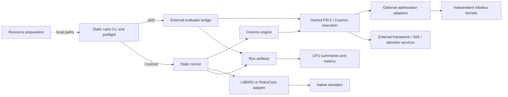
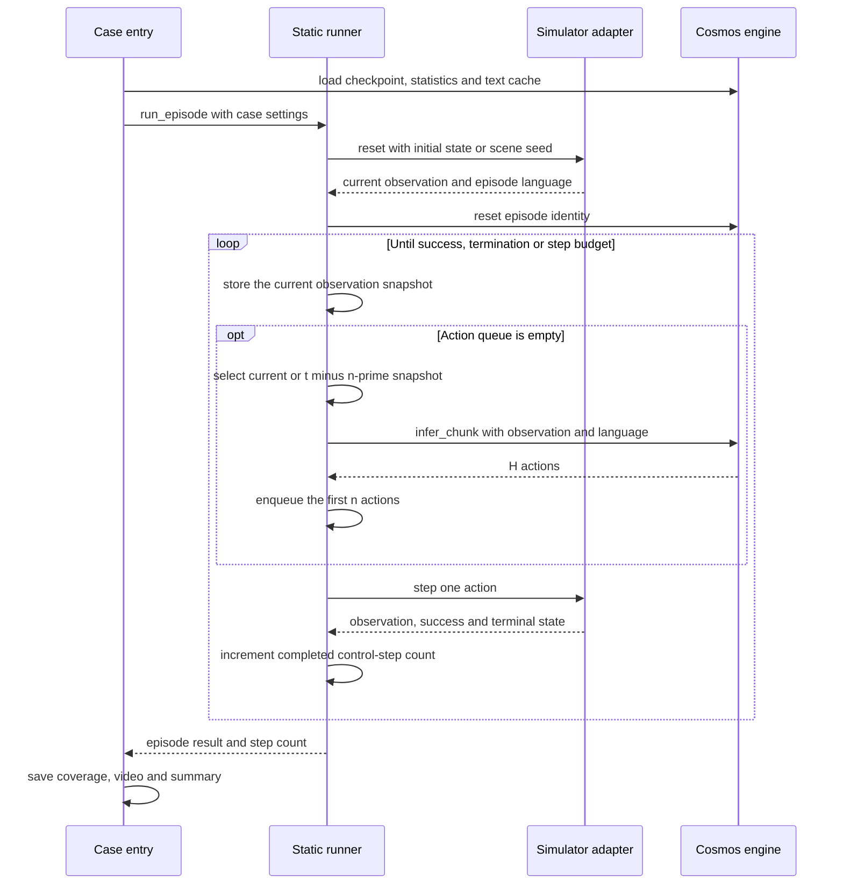

# 代码架构与执行流程

[项目首页](../README.zh-CN.md) · [环境配置](environment_setup.md) · [协作流程](../CONTRIBUTING.md)

一个 case 是一组可以一起运行的模型和任务环境。入口脚本准备资源并启动评测，模型引擎生成动作，runner 决定何时推理和执行哪些动作，模拟器返回新观测与任务结果。静态和动态任务各有自己的 runner，共用算子和统计工具。想先跑实验，请从[实操指南](hands-on.md)开始。

[LingBot＋RoboTwin](../benchmarks/static/lingbot_robotwin/README.md) 的模型单独运行，通过本机 WebSocket 与模拟器通信。`lingbot_runner.py` 在动作执行后更新 KV/VAE 缓存。启用 `paper_async` 时，关键帧 k 读取 max(0,k−n′) 的观测，缓存中的预测动作条件保持原位。

## 1. 以case组织实验

每个 case 指定模型权重、预处理、任务、模拟器和控制方式。例如，Cosmos 的两个 case 共用引擎代码，但分别加载自己的权重、统计量和相机输入，并使用对应的动作长度与运行环境。

| case | 模型调用 | 环境与执行 | 使用与验证指南 |
| --- | --- | --- | --- |
| `pi05_libero` | 外部evaluator调用本仓PI0.5执行代码；可显式选native参考 | 本仓桥接、初态适配、加载/覆盖审计 | [case指南](../benchmarks/static/pi05_libero/README.md) |
| `cosmos_libero` | 本仓 `CosmosEngine(suite="libero")` | 原生LIBERO adapter＋共享静态runner | [case指南](../benchmarks/static/cosmos_libero/README.md) |
| `cosmos_robocasa` | 本仓 `CosmosEngine(suite="robocasa")` | 原生RoboCasa adapter＋共享静态runner | [case指南](../benchmarks/static/cosmos_robocasa/README.md) |
| `lingbot_robotwin` | 外部LingBot模型worker＋本仓客户端 | RoboTwin双臂控制与sync/paper_async观测/cache更新循环 | [case指南](../benchmarks/static/lingbot_robotwin/README.md) |
| KINETIX | 仓内RTC flow model | 私有KINETIX/Jax2D源码与fine/coarse动态runner | [case指南](../benchmarks/dynamic/kinetix/README.md) |
| DynamicVLA＋DOM | 仓内模型与DOM适配 | 原生non-streaming/streaming，独立Isaac进程 | [case指南](../benchmarks/dynamic/dynamicvla_dom/README.md) |

## 2. 当前模块关系

实线表示运行调用或结果传递；虚线表示预先准备的配置输入。

先准备资源，再启动模型或模拟器；CPU 工具可以独立使用。π0.5 通过外部 evaluator 运行闭环，模型默认执行仓内的 policy、PaliGemma、Gemma 和 SigLIP 代码。Cosmos 先通过兼容的 loader 加载并检查权重，再使用仓内 policy、sampler 和 DiT；VAE 与 attention 库另行安装。需要原生参考实现时，选择 `--model-runtime native`。

## KINETIX仓内执行路径

`robotics_bench.kinetix` 包含 flow model、参数加载、虚拟延迟、回合运行和统计代码。KINETIX、Jax2D、关卡与纹理放在包内的私有目录，保留原来源和许可证；模型权重通过配置的 checkpoint 路径加载。

KINETIX 每次读取 symbolic 观测并预测 8 条动作，执行前 4 条后重新推理。fine 模式（兼容名 native-blend）在等待期间使用上一块动作的尾部。整个过程保持原生物理步长，分别记录采样步数和宿主耗时。统计由 `robotics_bench.statistics` 提供，旧 tools 路径仍可使用。

## DynamicVLA＋DOM原生执行路径

[DOM 入口](../benchmarks/dynamic/dynamicvla_dom/README.md) 启动模型和 Isaac 两个进程。模型、预处理和 streaming 队列在 `models/dynamicvla`，场景、控制和终止逻辑在 `dynamicvla_dom/native`。两端消息带有回合和观测编号，避免跨回合混用动作。

等待新动作时，世界继续按 0.04s 物理步推进。模型生成的 chunk、模拟器实际使用的 chunk 和控制步分别计数。SDK、模型与场景资产单独准备；源码的非商业条款见[第三方说明](../THIRD_PARTY_NOTICES.md)。

## 3. 文件职责与阅读顺序

| 文件或目录 | 职责 |
| --- | --- |
| [资源工具](../tools/prepare_resources.py) | 下载计划、本地复用、版本和文件检查、生成env配置 |
| [π0.5入口](../benchmarks/static/pi05_libero/run.py) | 参数解析、AST/文件预检、来源记录、调用外部evaluator |
| [π0.5环境适配](../benchmarks/static/pi05_libero/libero_adapter.py) | 指定初态、reset顺序和终止后的行为 |
| [π0.5评估审计](../benchmarks/static/pi05_libero/evaluation_audit.py) | 读取真实任务/初态ID，记录和核对episode覆盖 |
| [Cosmos LIBERO入口](../benchmarks/static/cosmos_libero/run.py) / [配置](../benchmarks/static/cosmos_libero/config.py) | 单环境运行生命周期、任务分配、CPU预检及报告 |
| [Cosmos RoboCasa入口](../benchmarks/static/cosmos_robocasa/run.py) / [配置](../benchmarks/static/cosmos_robocasa/config.py) | 固定任务/场景清单、初始化保存和reference比对 |
| [Cosmos引擎](../src/robotics_bench/engines/cosmos.py) | 原生模型加载、统计量和T5、图像预处理、动作块推理 |
| [Cosmos加载审计](../src/robotics_bench/engines/cosmos_load_guard.py) | 检查实际权重加载覆盖；限定允许的元数据兼容项 |
| [模型执行代码](../src/robotics_bench/models/) | PI0.5和Cosmos主要forward；各目录记录原始来源哈希 |
| [优化适配](../src/robotics_bench/optimizations/) / [算子](../src/robotics_kernels/README.md) | 实例范围开关、BF16融合、图缓存和显式低精度后端 |
| [推理实验](../benchmarks/inference/README.md) / [profile导出](../src/robotics_bench/profiling/) | 完整policy调用计时、数值比较、实测ledger和逐轮图表 |
| [LIBERO adapter](../src/robotics_bench/simulators/libero.py) | 任务初态、环境reset/step、成功与渲染 |
| [RoboCasa adapter](../src/robotics_bench/simulators/robocasa.py) | 场景初始化、动态语言、三相机、控制器动作映射 |
| [静态runner](../src/robotics_bench/protocols/static_runner.py) | 历史快照、请求触发、执行动作前缀、计数与终止 |
| [视频记录器](../benchmarks/static/pi05_libero/video_recorder.py) | 三个case复用的完整episode录像和元数据 |
| [统计核心](../tools/episode_statistics.py) / [汇总入口](../tools/summarize_experiment.py) | 失败预算、仅成功统计、任务加权、结果输出 |
| [加速比工具](../tools/compare_speedups.py) / [轨迹工具](../tools/embodied/README.md) | 声明时间域下的baseline比较、轨迹及导数指标 |

阅读代码时，先看 case 的 README 和配置，再看入口、模型引擎和模拟器，最后看 runner 与统计。RoboCasa 目前复用 Cosmos LIBERO 入口的日志和汇总辅助函数。

## 4. Cosmos的episode生命周期

- LIBERO 使用任务内的指定初态；RoboCasa 按任务、layout/style 和环境种子创建场景。两者的 settling 都在策略控制计数之外。
- RoboCasa 在 reset 后读取本回合语言，不能提前把任务名当成固定指令。模型缓存保留在 CPU，当前指令必须有对应 T5 embedding。
- `H` 是模型输出长度，`n` 是每次实际执行的前缀长度：LIBERO 为 H=16、默认 n=16，RoboCasa 为 H=32、默认 n=16。
- checkpoint 加载不完整、初始化比对失败或环境异常会使运行报错，不伪装成任务失败 episode。

一个模型实例可以服务多个回合，权重和文本缓存保留在实例中。每次开始新回合时，runner 重建动作队列和观测历史。模拟器判断任务是否结束，runner 负责调度和计数，engine 负责预处理、采样和动作归一化。

## 5. 论文异步与时间口径

Cosmos 的 `paper_async` 在控制步 t 读取 t−n′ 时刻的图像和 proprio；历史不足时使用当前观测。runner 仍按控制指令逐步推进环境。LingBot 则按前述规则延迟整个缓存观测流。

计算论文周期时，使用同一模型配置的完整推理时间 `Tinf`。具体公式见[异步实现](../benchmarks/static/pi05_libero/paper_async.py)和[加速比说明](protocols/speedup-metrics.md)。宿主耗时、仿真步长、视频 FPS 和用于估计的动作时间分别保存。

同步/异步均记录成功率和动作步数。总体步数对失败按预算惩罚；成功均值以成功回合为分母，详见[统计定义](protocols/speedup-metrics.md#8-控制步数统计与实验汇总)。

## 6. 配置、结果与契约的边界

`run.sh` 选定解释器，CLI 读取资源路径和实验参数。先用 `--dry-run` 检查配置，再执行实验；运行结束后查看 manifest、权重加载检查、逐回合结果和汇总。RoboCasa 还保存初始状态、XML 和观测 hash，可用 `--reference-run` 对照起点。

[schemas](../schemas/README.md) 定义通用 manifest 和 trace 格式。各 case 的实际输出文件见[产物说明](protocols/artifacts.md)，统计工具按对应格式读取回合记录。

路径与缓存设置见[环境指南](environment_setup.md)。日志、视频、权重和个人记录保存在忽略目录。

## 7. 优化与测量边界

优化默认关闭，通过重复 `--enable` 独立选择；精度由 `--precision` 和 `--quant-scope` 指定。INT4/INT8 采用真实 CUTLASS 整数 Tensor Core，融合准备、打包与必要转换均计入调用耗时。FP4/FP8 保留独立 Blackwell 源码，尚未完成目标硬件验证。

Cosmos 的两个 case 共用整数 Linear 和 VAE 优化代码。前缀裁剪根据相机与条件帧设置跳过不需要的编码后缀，保留完整 latent、噪声和 DiT 形状。使用规划或未来图像输出时，请关闭前缀裁剪，保留原始 clean-latent 后缀。启用方法见[量化指南](cosmos-quantization.md)。

CUDA Graph 和缓存属于各自的模型实例。调用期间保持权重不变，并依次处理请求；每次调用刷新变化的输入。π0.5 的相机缓存只复用缺失相机的占位图编码。退出优化上下文后，原方法和模块会恢复。

每轮测原始 BF16；低精度另对照相同共享优化的 BF16。计时从 CPU 观测到 CPU 动作，加载/编译/图捕获/warmup 单列。独立 profile 记录 GPU 时长，任务评估记录成功率；失败和变慢候选保留在历史结果中。

## 8. 后续扩展位置

- 新模型接入匹配 case 的模型或 engine 边界；新增低精度实现接入优化适配层，验证动作质量、真实 backend 和完整推理代价。
- 新模拟器实现 reset/step、观测、成功、渲染和控制时间；必要的模拟器内部改动放独立 fork，并固定来源版本。
- 动态 DOM 和 Kinetix 保留各自控制协议。Kinetix 采用原生 JAX 状态、PRNG 和 rollout，不要求经过 Torch 或 VLA 动作块接口。
- 通用服务/RPC 抽取以共享调用需求为依据；底层算子统一维护在 `src/robotics_kernels/`。

代码与协议变更遵循 [贡献流程](../CONTRIBUTING.md)。更多图稿见 [架构图目录](diagrams/README.md)，其中后续设计均单独标明状态。
