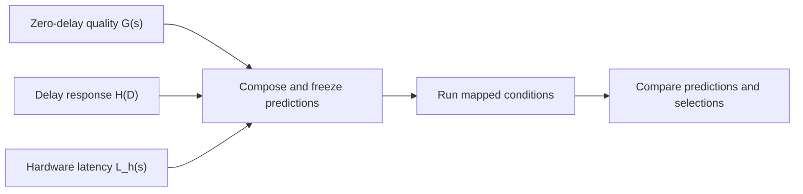

# Predictive TISED: choose sampling steps from calibrated responses

[中文](kinetix-latency-study.md) · [Experiment hands-on guide](hands-on.en.md) · [Environment setup](environment_setup.en.md) · [Single KINETIX run](../benchmarks/dynamic/kinetix/README.md)

This workflow implements the response-composition experiment in [paper §4.5, Predictive TISED](https://arxiv.org/html/2606.28529v3#S4.SS5). Measure policy quality, delay sensitivity and hardware inference time separately, then compose a success-rate curve for each platform and predict its preferred sampling count. Run hardware-mapped evaluation afterward to test the predictions.

Start with one task and 32 paired seeds per condition, then expand the study. Model, KINETIX and Jax2D execution source are maintained here; prepare a JAX environment and trusted RTC checkpoints.

## How the predictor works

Use **s** for sampling steps, selected by `--flow-steps`. This is separate from the number of action chunks generated during an episode. Build three inputs for each task:

| Input | How to measure it | Question answered |
| --- | --- | --- |
| `G(s)`: zero-delay success rate | Run s=1–5 with delay fixed to zero | How does the policy's task quality change with computation? |
| `H_mode(D)`: relative delay response | Fix s=5, sweep delay and normalize by zero-delay success | How does waiting for a result affect success? |
| `L_hardware(s)`: hardware latency | Measure complete action generation at s=1–5 on each platform | How long does this configuration take on that platform? |

Compose the prediction as:

$$
\widehat P_{h,m}(s)=\operatorname{clip}\!\left(G(s)\,H_m\!\left(d_m(L_h(s))\right),0,1\right).
$$

`d_m` is the delay mapping: fine retains the requested milliseconds; coarse rounds to a control period. For example, a zero-delay success rate of 0.8 and a relative delay factor of 0.75 produce a prediction of 0.6. These are illustrative values. Evaluate s=1–5 and select the integer with the highest predicted success, choosing the smaller s on ties.

The paper expresses the quality term as `acc_5 × g(alpha_Ada(s))`, where `alpha_Ada(s)=Tinf,Ada(s)/Tinf,Ada(5)`. **All hardware platforms share the same quality term for a given s.** Changing hardware replaces only the latency supplied to the delay response. [Paper Appendix B.2](https://arxiv.org/html/2606.28529v3#A2.SS2)



### Paper settings and the repository implementation

The repository follows the same separate-calibration, composition and validation workflow with these fitting choices:

| Component | Paper §4.5 / Appendix B.2 | Current analyzer |
| --- | --- | --- |
| Zero-delay quality | Task-specific constant or logistic response fitted by binomial maximum likelihood | Empirical rates at s=1–5; shape-preserving PCHIP interpolation for continuous plots |
| Fine delay response | Task-specific logistic or linear response normalized at zero delay | Binomial Hill fit compared with a no-delay-effect constant model using AIC |
| Coarse delay response | Coarse comparisons use rounded action delay | Effective-delay calibration lookup divided by zero-delay s=5 success |
| Composition and selection | Fix calibrated responses, then compare hardware predictions and measurements | Freeze integer predictions and plotted curve samples before validation and selection-error analysis |

At integer s, `G(s)` therefore uses the measured task result directly. The fine-mode Hill factor is `1 / (1 + (D / tau)^power)`; the analyzer uses factor 1 when the Hill model does not improve AIC sufficiently. See [fit_task_model / predict_success](../benchmarks/dynamic/kinetix/analyze_latency_study.py) for the implementation.

## Timing and experiment conditions

Both modes retain `physics_dt=1/60 s` and `frame_skip=2`: one control command takes 33.333 ms. The policy predicts eight commands and executes four before replanning. Fine mixes old/new actuator commands within the native physics slots; coarse uses nearest-even rounding to control periods. `native-blend` and `legacy-round` are compatibility aliases. See the [KINETIX delay protocol](../benchmarks/dynamic/kinetix/README.md#fine细粒度延迟) for the equations.

Calibration fixes s=5. Fine uses nine delays from 0 to 66.667 ms in 8.333 ms increments; coarse uses 0, 33.333 and 66.667 ms. Old/new commands share control noise, the initial old queue contains zero actions, and collision, joint and terminal checks retain the native physics grid.

The default hardware input is the [four-profile latency CSV](data/kinetix-hardware-latencies-20260811.csv): `local_ada`, `rtx3090`, `agx15` and `agx30`, each containing s=1–5. This archive contains historical PyTorch eager FP16 timings with same-architecture random weights. Using it with the trained JAX FP32 policy defines a **hardware-latency replay scenario**. For your own measurements, provide `--hardware-profiles` in the same CSV structure and record the model, dtype, timing scope and hardware identity. Mapped delays must remain within the calibration range.

## 1. Prepare runtime and analysis environments

Use the interpreters and checkpoint directory from an existing successful KINETIX run. On a new machine, first complete [CPU/analysis and KINETIX setup](environment_setup.en.md), which creates `.local/kinetix.env`. From the repository root, load that file; its policy directory must contain `worlds_l_catapult.pkl` for this walkthrough.

```bash
source .local/kinetix.env
export ROBOTICS_CPU_PYTHON="${ROBOTICS_CPU_PYTHON:-$PWD/.venv/bin/python}"
export KINETIX_ANALYSIS_PYTHON="${KINETIX_ANALYSIS_PYTHON:-$PWD/.local/envs/analysis/bin/python}"
"$KINETIX_ANALYSIS_PYTHON" -c 'import numpy, scipy, matplotlib; print("Analysis environment ready")'
```

The runtime environment handles JAX/Flax and GPU simulation. The analysis environment handles NumPy, SciPy and Matplotlib. The orchestrator uses the Python standard library. Keep each virtual environment's `bin/python` path so its dependencies remain selected.

Declare a fixed task/seed set and new output directories. `KINETIX_GPU=0` is an example; select an idle GPU on your machine:

```bash
export KINETIX_TASKS=catapult
export KINETIX_EPISODES=32
export KINETIX_START_SEED=0
export KINETIX_GPU=0
export KINETIX_QUALITY=runs/dynamic/kinetix/predictor_pilot_quality_001
export KINETIX_STUDY=runs/dynamic/kinetix/predictor_pilot_001
```

## 2. Measure zero-delay quality G(s)

First preflight the resources. This reads file identities and prints the plan without starting JAX or the simulator:

```bash
bash benchmarks/dynamic/kinetix/run.sh \
  --levels catapult --flow-steps 1,2,3,4,5 --latencies-ms 0 \
  --mapping fine --episodes "$KINETIX_EPISODES" \
  --start-seed "$KINETIX_START_SEED" \
  --output-dir "$KINETIX_QUALITY/catapult" --dry-run
```

Then run the quality sweep. Each task gets a separate subdirectory containing the complete s=1–5 grid, matching the planner's expected layout:

```bash
for task in ${KINETIX_TASKS//,/ }; do
  bash benchmarks/dynamic/kinetix/run.sh \
    --levels "$task" --flow-steps 1,2,3,4,5 --latencies-ms 0 \
    --mapping fine --episodes "$KINETIX_EPISODES" \
    --start-seed "$KINETIX_START_SEED" --gpu "$KINETIX_GPU" \
    --validate-native --output-dir "$KINETIX_QUALITY/$task"
done
```

Inspect `case-manifest.json`, `episodes.jsonl` and `summary.md` in each task directory. The example produces 5×32=160 quality episodes. Delay response is normalized by zero-delay s=5 success, so this anchor must be positive. If it is zero, check the checkpoint/task binding, establish a policy that can perform the task, and rebuild the quality baseline.

## 3. Create a fixed study plan

```bash
"$ROBOTICS_CPU_PYTHON" benchmarks/dynamic/kinetix/latency_study.py plan \
  --quality-run "$KINETIX_QUALITY" \
  --policy-dir "$ROBOTICS_KINETIX_POLICY_DIR" \
  --tasks "$KINETIX_TASKS" --episodes "$KINETIX_EPISODES" \
  --start-seed "$KINETIX_START_SEED" --output-dir "$KINETIX_STUDY"
```

The plan binds tasks, s, delays, seeds, source and checkpoint identity. Inspect `study.json` and the summary printed by plan before execution; `status.json` is created when the first run phase starts. One task has 57 logical conditions and 31 unique new execution conditions. Conditions with the same task, s and float32 command weights share results with explicit provenance. The example adds 992 study episodes and 20 verification rollouts, for 1172 rollouts including the quality baseline.

## 4. Verify zero-delay execution consistency

```bash
"$ROBOTICS_CPU_PYTHON" benchmarks/dynamic/kinetix/latency_study.py run \
  --study-dir "$KINETIX_STUDY" --phase verification \
  --python "$ROBOTICS_KINETIX_PYTHON" --gpus "$KINETIX_GPU"
```

Verification repeats two existing seeds under both modes and s=1–5, checking native configuration, initialization and execution outcomes. After success, the verification phase in `status.json` is completed and the quality data can be used for calibration.

## 5. Calibrate delay response at s=5

```bash
"$ROBOTICS_CPU_PYTHON" benchmarks/dynamic/kinetix/latency_study.py run \
  --study-dir "$KINETIX_STUDY" --phase calibration \
  --python "$ROBOTICS_KINETIX_PYTHON" --gpus "$KINETIX_GPU"
```

This phase scans the fine/coarse delay grids above with the same seeds as the quality sweep. The zero-delay anchor reuses the quality data. Wait until calibration is completed before freezing; collecting all calibration cells first separates data-collection problems from fit diagnostics.

## 6. Freeze predictions and inspect the recommended sampling count

```bash
"$KINETIX_ANALYSIS_PYTHON" benchmarks/dynamic/kinetix/analyze_latency_study.py freeze \
  --study-dir "$KINETIX_STUDY"
```

Freezing writes `calibration/frozen-model.json`, `predictions.csv`, `cells.csv` and `report.md`. These contain the G/H models, predictions for every hardware condition, plotted curves and calibration-source hashes. Hardware-mapped validation outcomes have not entered the fit.

This read-only command joins the condition IDs in `predictions.csv` with the study plan and prints the recommended s for each task, mode and hardware profile:

```bash
"$ROBOTICS_CPU_PYTHON" - <<'PY'
import csv, json, os
from pathlib import Path
root = Path(os.environ["KINETIX_STUDY"])
study = json.loads((root / "study.json").read_text())
conditions = {c["id"]: c for c in study["conditions"]}
groups = {}
with (root / "calibration/predictions.csv").open() as stream:
    for row in csv.DictReader(stream):
        c = conditions[row["condition_id"]]
        key = (c["task"], c["mode"], c["hardware"])
        groups.setdefault(key, []).append((float(row["predicted_success"]), c["flow_steps"]))
print("task,mode,hardware,recommended_steps,predicted_success")
for key, rows in sorted(groups.items()):
    best = max(r[0] for r in rows)
    probability, steps = min((r for r in rows if abs(r[0] - best) < 1e-12), key=lambda r: r[1])
    print(",".join(map(str, (*key, steps, probability))))
PY
```

Read `calibration/report.md` and `frozen-model.json` as well. `kind` identifies Hill, constant or coarse lookup. `calibration_rmse` measures disagreement with calibration points. `requires_review` is set when RMSE or the largest upward rate change exceeds 0.1; inspect the response shape and sampling noise when it appears. This is a descriptive diagnostic rather than a significance test. Changes to tasks, data or model after freezing require a new study.

## 7. Evaluate hardware-mapped conditions

```bash
"$ROBOTICS_CPU_PYTHON" benchmarks/dynamic/kinetix/latency_study.py run \
  --study-dir "$KINETIX_STUDY" --phase validation \
  --python "$ROBOTICS_KINETIX_PYTHON" --gpus "$KINETIX_GPU"
```

Each hardware condition injects its CSV latency `L_hardware(s)` into the same policy and physics environment and measures rollout success. The validation phase records the frozen-prediction hash. Analysis checks that predictions, study plan and calibration evidence still match.

Validation uses the same paired seeds to compare delay conditions. It tests **held-out experimental conditions**, rather than new seeds or scenes. Cells reusing quality/calibration data are marked `calibration_overlap` and excluded from held-out RMSE.

## 8. Generate the report and read the four-panel figure

```bash
"$KINETIX_ANALYSIS_PYTHON" benchmarks/dynamic/kinetix/analyze_latency_study.py report \
  --study-dir "$KINETIX_STUDY" --plots
```

Start with `analysis/report.md`, then open each task/mode's `*-four-panel.png` or PDF:

| Panel | Horizontal axis and content | Interpretation |
| --- | --- | --- |
| Hardware latency | s and complete inference latency by platform | How computation becomes waiting time |
| Zero-delay quality | s and G(s) | Whether additional computation improves the task |
| Fixed-policy delay response | Delay and s=5 success/calibrated curve | How sensitive the task is to stale actions |
| Composed prediction and measurement | s, predicted curves and measured points by platform | Whether the prediction selects a high-success operating point |

`analysis/validation.csv` provides the comparison fields:

| Field | Meaning |
| --- | --- |
| `predicted_best_integer` | s selected before validation |
| `observed_best_integers` | All integer s tied for the highest measured success |
| `heldout_rmse` / `heldout_cells` | Prediction error and condition count after excluding calibration overlap |
| `empirical_selection_gap` | Best measured success minus measured success at the predicted selection; smaller is better |
| `calibration_overlap_cells` | Validation conditions that reuse quality/calibration results |

Observed success rates have 95% Wilson intervals. Selection-gap intervals use paired-seed bootstrap, with 2000 replicates by default, conditional on the frozen predictions. Step summaries include all episodes with failures penalized at the 256-step budget and successful episodes separately. Execution errors have separate records.

## Scale up or supply your own hardware measurements

Choose tasks and sample size before creating new quality and study directories. Repository defaults are `mjc_walker,catapult,trampoline,mjc_half_cheetah` with 512 seeds per condition. Paper §4.5 uses Grasp, Half-cheetah and Walker with 1024 paired seeds; their repository task IDs are `grasp_easy,mjc_half_cheetah,mjc_walker`.

Change the Step 1 variables to your task set and `KINETIX_EPISODES=512` or `1024`, then repeat from Step 2. Quality collection and planning must use matching tasks, episode counts and starting seeds; quality collection always covers s=1–5. The 32-seed example teaches the workflow. Interpret study results using the predeclared sample size and confidence intervals.

Pass your CSV through the planner's `--hardware-profiles /path/to/profiles.csv`. It reads `profile_id,flow_steps,latency_ms` and requires all four profile IDs above, each with s=1–5; additional provenance columns can be retained. Latencies are in milliseconds. Re-plan after changing the archive so the hardware input becomes part of the fixed provenance.

## Outputs, resume and automatic execution

| Path | Purpose |
| --- | --- |
| `study.json` / `profiles/` | Fixed plan and hardware inputs |
| `status.json` | Phases, jobs, GPU/PID assignments and artifact paths |
| `executions/<task>/<job>/attempt-*/` | Per-attempt manifests, logs, episode and request records |
| `calibration/frozen-model.json` | Model and predictions frozen before validation |
| `analysis/` | Error, selection, success-rate, figure and provenance outputs |

```bash
"$ROBOTICS_CPU_PYTHON" benchmarks/dynamic/kinetix/latency_study.py status --study-dir "$KINETIX_STUDY"
```

After interruption, repeat the same `run --phase ...` command. Complete jobs are reused after hash checks; live workers are adopted by PID and output path. A stopped incomplete job keeps its old attempt and restarts as a whole in a new attempt. `--reuse-study /path/to/previous-study` explicitly reuses matching jobs from another study; retain the source directory.

Once familiar with the individual phases, let the controller run verification, calibration, freeze, validation and reporting in order:

```bash
"$ROBOTICS_CPU_PYTHON" benchmarks/dynamic/kinetix/latency_study.py finish \
  --study-dir "$KINETIX_STUDY" \
  --python "$ROBOTICS_KINETIX_PYTHON" \
  --analysis-python "$KINETIX_ANALYSIS_PYTHON" --gpus "$KINETIX_GPU"
```

`--gpus 0,1,2` assigns multiple idle GPUs. Each worker uses 16 CPU cores by default; adjust with `--cpus-per-worker`. The controller waits for the specified GPUs to become idle; use tmux for long runs. Each job retains single-environment stepping. Logs, models, figures and reports stay in ignored `runs/` directories; stable code and operating guides are tracked by Git.
