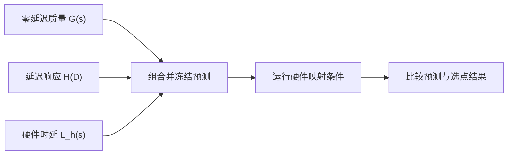

# Predictive TISED：从校准数据预测最佳采样步数

[English](kinetix-latency-study.en.md) · [实验操作总览](hands-on.md) · [环境配置](environment_setup.md) · [KINETIX 单次运行](../benchmarks/dynamic/kinetix/README.md)

这份教程回答一个问题：换一张 GPU 后，应该用多少个采样步？按照论文 [§4.5 Predictive TISED](https://arxiv.org/html/2606.28529v3#S4.SS5) 的方法，我们先测量策略质量、延迟带来的影响和硬件推理时间，再预测每个平台上表现最好的采样步数，最后运行实验检查预测。

先用一个任务跑通下面的步骤，再增加任务或回合数。开始前需要配置好 JAX 环境和 RTC 模型权重。

## 预测器如何工作

采样步数记为 **s**，对应 `--flow-steps`；它与一回合生成的动作块数量是两个指标。每个任务分别构建以下三份输入：

| 输入 | 怎么获得 | 回答的问题 |
| --- | --- | --- |
| `G(s)`：零延迟成功率 | 保持延迟为0，运行s=1～5 | 计算量改变后，策略本身有多大机会完成任务？ |
| `H_mode(D)`：相对延迟响应 | 固定s=5，扫描延迟，以零延迟成功率归一化 | 等待结果会损失多少任务成功率？ |
| `L_hardware(s)`：硬件时延 | 每个平台测量s=1～5的完整动作生成时间 | 该平台会给这个配置引入多长等待？ |

组合预测为：

$$
\widehat P_{h,m}(s)=\operatorname{clip}\!\left(G(s)\,H_m\!\left(d_m(L_h(s))\right),0,1\right).
$$

`d_m` 是延迟映射：fine保持输入毫秒数，coarse取整到控制周期。例如，某配置的零延迟成功率为0.8，硬件时延对应的相对延迟因子为0.75，则组合预测为0.6；这是说明公式的示例，不是实测结果。对s=1～5逐个计算后，选择预测成功率最大的整数s，并列时选择较小s。

论文把质量项写成 `acc_5 × g(alpha_Ada(s))`，其中 `alpha_Ada(s)=Tinf,Ada(s)/Tinf,Ada(5)`。**同一s在所有硬件上使用同一个质量项**；更换硬件时只替换送入延迟响应的 `L_hardware(s)`。[论文附录B.2](https://arxiv.org/html/2606.28529v3#A2.SS2)



下面通过现有命令运行预测器。想了解拟合方法，可以查看[实现代码](../benchmarks/dynamic/kinetix/analyze_latency_study.py)。

## 时间与实验条件

两种模式都保持 `physics_dt=1/60 s`、`frame_skip=2`，每条控制指令33.333 ms；预测8条动作、执行4条后刷新。fine按原生物理槽混合新旧执行器指令，coarse按控制周期nearest-even取整。`native-blend`、`legacy-round`分别是兼容别名。完整公式见 [KINETIX延迟模式](../benchmarks/dynamic/kinetix/README.md#fine细粒度延迟)。

本工作流使用9个fine校准延迟：0～66.667 ms，间隔8.333 ms；coarse使用0、33.333和66.667 ms。固定s=5进行延迟校准。新旧指令共用控制噪声，初始旧队列为零动作，碰撞、关节求解和终止检查保留原生物理网格。

默认硬件输入是 [四档延迟CSV](data/kinetix-hardware-latencies-20260811.csv)，包含 `local_ada`、`rtx3090`、`agx15`、`agx30`，每档必须完整包含s=1～5。该档案来自历史PyTorch eager FP16、同架构随机权重计时；在本页JAX FP32 policy上作为**硬件延迟场景重放**使用。若测量自己的平台，按相同CSV结构提供 `--hardware-profiles`，并记录模型、dtype、计时边界与硬件身份。分析器要求映射延迟落在本轮校准范围内。

<a id="环境与输入"></a>
## 1. 准备运行与分析环境

已有跑通的KINETIX实验时，沿用其解释器与checkpoint目录。新机器先完成[CPU/分析及KINETIX环境配置](environment_setup.md)，生成 `.local/kinetix.env`。在仓库根目录加载该文件，确认策略目录包含本教程使用的 `worlds_l_catapult.pkl`。

```bash
source .local/kinetix.env
export ROBOTICS_CPU_PYTHON="${ROBOTICS_CPU_PYTHON:-$PWD/.venv/bin/python}"
export KINETIX_ANALYSIS_PYTHON="${KINETIX_ANALYSIS_PYTHON:-$PWD/.local/envs/analysis/bin/python}"
"$KINETIX_ANALYSIS_PYTHON" -c 'import numpy, scipy, matplotlib; print("Analysis environment ready")'
```

运行环境负责JAX/Flax和GPU仿真；分析环境负责NumPy、SciPy与Matplotlib；编排器使用Python标准库。保持虚拟环境的 `bin/python` 路径，以便加载对应环境。

为本次实验声明一个固定的任务、seed集合和新输出目录。`KINETIX_GPU=0` 是示例，请改为本机空闲GPU编号：

```bash
export KINETIX_TASKS=catapult
export KINETIX_EPISODES=32
export KINETIX_START_SEED=0
export KINETIX_GPU=0
export KINETIX_QUALITY=runs/dynamic/kinetix/predictor_pilot_quality_001
export KINETIX_STUDY=runs/dynamic/kinetix/predictor_pilot_001
```

<a id="运行工作流"></a>
## 2. 测量零延迟质量 G(s)

先预检所需资源；它读取文件身份并打印计划，不启动JAX或模拟器：

```bash
bash benchmarks/dynamic/kinetix/run.sh \
  --levels catapult --flow-steps 1,2,3,4,5 --latencies-ms 0 \
  --mapping fine --episodes "$KINETIX_EPISODES" \
  --start-seed "$KINETIX_START_SEED" \
  --output-dir "$KINETIX_QUALITY/catapult" --dry-run
```

随后执行质量扫描。每个任务独占一个子目录，保存完整s=1～5结果；这正是规划器读取的布局：

```bash
for task in ${KINETIX_TASKS//,/ }; do
  bash benchmarks/dynamic/kinetix/run.sh \
    --levels "$task" --flow-steps 1,2,3,4,5 --latencies-ms 0 \
    --mapping fine --episodes "$KINETIX_EPISODES" \
    --start-seed "$KINETIX_START_SEED" --gpu "$KINETIX_GPU" \
    --validate-native --output-dir "$KINETIX_QUALITY/$task"
done
```

检查每个任务目录中的 `case-manifest.json`、`episodes.jsonl` 和 `summary.md`。本例产生5×32=160个质量回合。延迟响应用s=5零延迟成功率作分母，因此该锚点必须大于0；若为0，先检查checkpoint/任务绑定，再确定可用于该任务的policy并重新建立质量基线。

## 3. 生成固定实验计划

```bash
"$ROBOTICS_CPU_PYTHON" benchmarks/dynamic/kinetix/latency_study.py plan \
  --quality-run "$KINETIX_QUALITY" \
  --policy-dir "$ROBOTICS_KINETIX_POLICY_DIR" \
  --tasks "$KINETIX_TASKS" --episodes "$KINETIX_EPISODES" \
  --start-seed "$KINETIX_START_SEED" --output-dir "$KINETIX_STUDY"
```

命令会生成 `study.json`，并打印计划执行的任务和回合数。确认设置后再继续；下一步开始运行时才会生成 `status.json`。

## 4. 核对零延迟运行一致性

```bash
"$ROBOTICS_CPU_PYTHON" benchmarks/dynamic/kinetix/latency_study.py run \
  --study-dir "$KINETIX_STUDY" --phase verification \
  --python "$ROBOTICS_KINETIX_PYTHON" --gpus "$KINETIX_GPU"
```

该阶段在两种延迟模式、s=1～5上复查两个已有seed，核对原生配置、初态和执行结果。通过后，`status.json` 中verification阶段标为completed，质量数据可以用于后续校准。

## 5. 固定s=5，校准延迟响应

```bash
"$ROBOTICS_CPU_PYTHON" benchmarks/dynamic/kinetix/latency_study.py run \
  --study-dir "$KINETIX_STUDY" --phase calibration \
  --python "$ROBOTICS_KINETIX_PYTHON" --gpus "$KINETIX_GPU"
```

这个阶段扫描上述fine/coarse延迟网格，保留与质量扫描相同的seed集合。零延迟锚点直接复用质量数据。等待calibration标为completed后执行冻结；先完成校准、再拟合，便于区分数据采集问题和模型拟合问题。

## 6. 冻结预测，先看推荐的采样步数

```bash
"$KINETIX_ANALYSIS_PYTHON" benchmarks/dynamic/kinetix/analyze_latency_study.py freeze \
  --study-dir "$KINETIX_STUDY"
```

冻结会保存 `calibration/frozen-model.json`、`predictions.csv`、`cells.csv` 和 `report.md`。其中包含G/H模型、每个硬件条件的预测、绘图曲线以及校准来源哈希。此时尚未使用硬件映射验证结果。

下面的只读命令把 `predictions.csv` 的条件编号与计划关联，显示每个任务、模式和硬件的推荐s：

```bash
"$ROBOTICS_CPU_PYTHON" - <<'PY'
import csv, json, os
from pathlib import Path
root = Path(os.environ["KINETIX_STUDY"])
study = json.loads((root / "study.json").read_text())
conditions = {c["id"]: c for c in study["conditions"]}
groups = {}
with (root / "calibration/predictions.csv").open() as stream:
    for row in csv.DictReader(stream):
        c = conditions[row["condition_id"]]
        key = (c["task"], c["mode"], c["hardware"])
        groups.setdefault(key, []).append((float(row["predicted_success"]), c["flow_steps"]))
print("task,mode,hardware,recommended_steps,predicted_success")
for key, rows in sorted(groups.items()):
    best = max(r[0] for r in rows)
    probability, steps = min((r for r in rows if abs(r[0] - best) < 1e-12), key=lambda r: r[1])
    print(",".join(map(str, (*key, steps, probability))))
PY
```

打开 `calibration/report.md` 查看拟合结果，再用上面的命令查看推荐步数。如果需要修改任务或校准数据，请使用新的输出目录重新运行。

## 7. 运行硬件映射验证

```bash
"$ROBOTICS_CPU_PYTHON" benchmarks/dynamic/kinetix/latency_study.py run \
  --study-dir "$KINETIX_STUDY" --phase validation \
  --python "$ROBOTICS_KINETIX_PYTHON" --gpus "$KINETIX_GPU"
```

这一步会按 CSV 中各硬件的延迟运行仿真，保存实际结果，稍后与已经保存的预测进行比较。

验证会尝试新的“采样步数＋延迟”组合，随机 seed 保持不变。报告会自动区分新结果和复用的校准结果。

## 8. 生成报告并解读四联图

```bash
"$KINETIX_ANALYSIS_PYTHON" benchmarks/dynamic/kinetix/analyze_latency_study.py report \
  --study-dir "$KINETIX_STUDY" --plots
```

先读 `analysis/report.md`，再看每个任务/模式的 `*-four-panel.png` 或PDF：

| 面板 | 横轴与内容 | 如何解读 |
| --- | --- | --- |
| 硬件时延 | s与各平台完整推理时延 | 计算预算如何变成等待时间 |
| 零延迟质量 | s与G(s) | 增加计算是否改善这个任务 |
| 固定policy延迟响应 | 延迟与s=5成功率/拟合曲线 | 这个任务对过时动作有多敏感 |
| 组合预测与实测 | s与各平台的预测曲线、实测点 | 预测是否选中了高成功率的工作点 |

`analysis/validation.csv` 提供可直接比较的结果：

| 字段 | 含义 |
| --- | --- |
| `predicted_best_integer` | 验证前预测选定的s |
| `observed_best_integers` | 实测成功率最高的整数s集合，保留并列 |
| `heldout_rmse` / `heldout_cells` | 排除校准重叠点后的预测误差与条件数 |
| `empirical_selection_gap` | 实测最优成功率减去预测选点的实测成功率；越小越好 |
| `calibration_overlap_cells` | 复用质量/校准结果的验证条件数 |

<a id="实验范围与任务选择"></a>
## 扩大规模与换用自己的硬件数据

要增加任务或回合数，修改第1步的 `KINETIX_TASKS` 和 `KINETIX_EPISODES`，换一个输出目录，再从第2步开始运行。质量扫描与 `plan` 使用同一组变量。

自定义硬件档案通过plan的 `--hardware-profiles /path/to/profiles.csv` 指定。规划器读取 `profile_id,flow_steps,latency_ms` 三列，并要求上述四个profile ID各包含s=1～5；额外来源列可保留。延迟单位为毫秒。更新档案后重新plan，使硬件数据进入固定来源记录。

<a id="输出与版本管理"></a>
## 输出、恢复与自动执行

| 路径 | 用途 |
| --- | --- |
| `study.json` / `profiles/` | 固定计划与硬件输入 |
| `status.json` | 阶段、job、GPU、PID与产物路径 |
| `executions/<task>/<job>/attempt-*/` | 每次执行的manifest、日志、回合与请求记录 |
| `calibration/frozen-model.json` | 验证前冻结的模型与预测 |
| `analysis/` | 误差、选点、成功率、图表与来源记录 |

```bash
"$ROBOTICS_CPU_PYTHON" benchmarks/dynamic/kinetix/latency_study.py status --study-dir "$KINETIX_STUDY"
```

中断后，重新执行原来的 `run --phase ...` 命令即可。已完成的 job 会跳过，未完成的 job 会从头重跑，并把新结果放到新的 attempt 目录中，保留之前的文件。需要复用另一组实验时，加上 `--reuse-study /path/to/previous-study`，并保留那个目录。

熟悉分阶段操作后，可让控制器按顺序完成verification、calibration、freeze、validation和report：

```bash
"$ROBOTICS_CPU_PYTHON" benchmarks/dynamic/kinetix/latency_study.py finish \
  --study-dir "$KINETIX_STUDY" \
  --python "$ROBOTICS_KINETIX_PYTHON" \
  --analysis-python "$KINETIX_ANALYSIS_PYTHON" --gpus "$KINETIX_GPU"
```

`--gpus 0,1,2` 可分配多个空闲GPU，默认每个worker绑定16个CPU核，使用 `--cpus-per-worker` 调整。控制器等待指定GPU空闲后启动；长实验可在tmux中运行。每个job保持单环境步进。所有日志、模型、图表和报告保存在忽略的 `runs/`，稳定代码与操作文档由Git管理。
