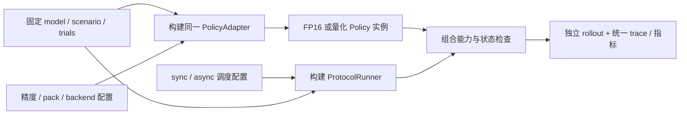

# 同模型、同任务下的组合轻量化实验

想比较“量化”“异步”以及两者叠加的效果，先固定同一个模型与任务，再分别调整精度和调度。本页说明如何组织这些对照，实际命令见 [实验操作指南](../hands-on.md)。下文的通用 builder 与 YAML 仍是接口设计，不能作为 manifest v1 配置运行。

一次运行由 **固定 case + 模型变换/执行配置 + 调度策略 + 时间/延迟模式** 组成。量化改变模型怎样计算，异步改变推理与动作怎样配合。把这两部分分开配置，才能看清各自的收益和交互作用。

静态和动态任务分别建立 case 与 baseline。每个 case 指定模型、checkpoint、processor、任务、模拟器和协议，并在这些组件支持的范围内组合优化。

## 1. 先固定实验案例

| 固定项 | 需要保存的内容 |
| --- | --- |
| 基础模型 | 架构、同源 checkpoint hash、adapter、processor版本/hash、预处理/action normalization |
| 任务场景 | simulator及依赖版本、任务定义、资产、初始状态集合、外部扰动 |
| 执行语义 | control/physics dt、预测 horizon、实际执行长度、采样/接管/欠载规则 |
| 生成参数 | denoise/refinement steps、基础采样策略；不与量化一起隐式改变 |
| 预算与判据 | 相同任务预算及时间域、成功/失败/timeout定义 |
| 硬件条件 | 设备、功耗/频率、软件、资源共部署、计时边界、warmup与采样方法 |
| 随机输入 | 初始场景、环境随机流、policy噪声、延迟随机流；各自独立记录 |

“同一模型”指相同架构与共同基础 checkpoint。packed 权重独立记录 hash、校准和量化配置；校准/调参与最终评估使用分开的数据。

“同一场景”指相同任务、初态、环境规律和可比随机输入。闭环动作可产生不同后续观测/轨迹；固定录制观测则属于单独的离线 replay 实验。

## 2. 量化与异步使用两个独立配置轴

| 配置轴 | 作用位置 | 例子 |
| --- | --- | --- |
| 模型精度/变换 | 加载、校准/pack、算子映射、backend | FP16、W8A8、W4A16；具体层与scale显式列出 |
| 调度策略 | ProtocolRunner / executor / action queue | sync、async；触发时刻、在途请求、接管/过期规则 |
| 时间与延迟 | world clock / delay provider | 固定外生延迟、实际profile重放、实测墙钟 |

`sync`定义推理与动作的执行顺序；等待时的世界演化由独立的 `world_progression` 定义。四组对照固定后者；动态同步等待期间也按相同 hold 规则推进世界。

任务类型与调度分别配置：静态可采用 async，动态可采用 sync；静态闭环仍按任务协议推进物理世界。

重规划间隔、overlap 深度、预测 horizon 和实际执行长度分别命名、记录与扫描。

## 3. 第一轮采用2×2实验矩阵

运行矩阵时保持模型、任务和权重一致，并标明不支持的组合。静态与动态 case 分别计算相对 baseline 的结果，再按各自任务汇总。

| run | 精度/执行路径 | 调度 | 回答的问题 |
| --- | --- | --- | --- |
| F-S | 同源FP16 baseline | 同步 | 基准 |
| Q-S | 指定量化变体 | 同步 | 量化在同步条件下的效果 |
| F-A | 同一个FP16变体 | 指定异步策略 | 异步在FP16条件下的效果 |
| Q-A | 同一个量化变体 | 同一异步策略参数 | 二者组合及交互作用 |

先比较 Q-S/F-S、F-A/F-S；再比较 Q-A/F-A（异步下量化效果）及 Q-A/Q-S（量化后异步效果）。最后把所有配置按成功率、任务代价和资源限制共同评估。

主表统一相对 F-S baseline 计算；其他配对关系另标增量效果。论文定义的推理、动作块周期与任务加速比及计算工具见 [统一加速比协议](speedup-metrics.md)。

组合收益按共同 baseline 直接计算。推理完全隐藏于旧动作窗口时，量化可减少 GPU 工作量而保持交接时间不变，因此单项 speedup 不能直接相加或相乘。

外围 fusion、compiler flags 及 backend 也要记录。如果量化仅能通过另一个 backend 执行，Q-S/F-S 测得的是“量化＋后端变化”的部署效果；要隔离位宽影响，需要同后端的浮点对照或补充 backend 消融。针对某个精度专用的 norm+quant 融合可成为该方案的一部分，另以消融解释其贡献。

## 4. 代码如何组合



以下为通用 builder 接口伪代码，函数尚未实现：

```python
policy = build_policy(shared_case.model, precision_config)
runner = build_runner(schedule_config, shared_case.world, delay_config)
validate_combination(policy, runner)
result = runner.run(policy, shared_case.scenario, shared_case.trials)
```

PolicyAdapter 的 observation→action 契约不因量化而改变。量化只替换符合精度计划的内部执行路径；async runner 通过 worker/完成句柄组织同一个 policy，保留输出可消费时刻、输入快照和 episode 来源。

上述 worker 与动作队列用于相应 VLA case。Kinetix 继续使用 [原生 policy 与 JAX rollout](../../benchmarks/dynamic/kinetix/README.md)，在自己的执行路径测试优化。是否真正重叠推理与环境步进，以事件时间线为准；不兼容的组合标为不支持。

每个变体独立构建或恢复到干净状态；浮点 baseline 使用原始权重。四组隔离可写 KV、workspace、queue 和随机流；非线程安全实例限制单个在途请求或独立部署。

组合检查覆盖 kernel 能力、形状/精度、状态生命周期、世界推进和 buffer ownership。精度 fallback 须报错，或按预先声明的混合配置记录实际层与耗时。

## 5. 配置应怎样写

以下 YAML 展示配置结构；引用 ID 为占位符，尚未绑定模型、校准集或设备：

```yaml
experiment:
  shared_case: pi05_libero_case_v1
  # 此case包含同源checkpoint、任务/初态、设备、控制周期、预算与随机流

policy_variants:
  fp16:
    transform: none
    execution_profile: fp16_backend_v1
  w8a8:
    transform: quantize
    precision_plan: w8a8_layers_v1
    calibration: calibration_set_v1
    execution_profile: w8a8_backend_v1

schedulers:
  sync:
    mode: sync
  async:
    mode: async
    trigger: remaining_actions
    trigger_value: 2
    max_inflight: 1
    handover: finish_current_chunk

matrix:
  policy_variant: [fp16, w8a8]
  scheduler: [sync, async]
```

`shared_case` 还必须包含共同的过期/欠载语义，policy variants 导出实际层 map 与 kernel，delay 配置为每个组合绑定明确来源。有效执行长度不足以使用触发值 2 时，组合检查应拒绝。加入新精度或新调度时扩展配置，不复制四份模型代码或四份 rollout 脚本。

## 6. 分清两种延迟实验

**机制对照：** 固定观测/噪声检查 policy 误差，或给精度变体施加相同外生延迟，隔离数值与调度影响。人工延迟及离线 replay 作为机制实验单列。

**部署对照：** 使用各配置实测耗时，联合观察数值误差、观测年龄与 SR。async 的效果通过重叠、等待和动作节拍解释，完整推理耗时另测。

精度、fusion、shape、steps 或 backend 变化后重测 profile；共享 GPU 的推理/仿真/渲染还需记录共部署计时。虚拟重放与宿主计算分列，按 [仿真协议](simulation.md)避免重复计时。

第一轮固定 async 参数比较；如果随后为每个精度分别调优 overlap/触发点，应作为另一轮“各自调优后”的结果，保存调参预算与独立验证集，不能与固定参数矩阵混为单因素比较。

## 7. 指标和更复杂的方法

统一输出实际精度/backend/fallback、policy p50/p95、动作发布间隔、observation age、队列欠载/过期、峰值内存，以及全部试验的 SR、失败/timeout 和固定预算代价。成功条件任务时间和共同成功 seed 的比较作为补充，不替代全部试验结果。

环境、policy 噪声和延迟采样使用独立随机流，保存 seed/初态及实际请求/动作序列；异步调用顺序下按各流核对可比性。

普通 async 属于执行策略，不需要改基础模型参数。FAAC 等学习式纠正、QAT 或模型蒸馏还涉及训练和派生权重，应新增模型/训练因素，设置对应训练基线并记录 checkpoint lineage。它们可以继续与量化和调度组合，但不能宣称只改了一个运行时开关。实现时在 Issue/PR 说明训练方法与派生权重，保留公开论文/源码来源。

## 8. 在当前项目中落地

现有 case 通过 CLI 选择精度和调度，完整操作见 [hands-on 指南](../hands-on.md)。新增通用组合层时，按配置/校验、模型 backend、调度与矩阵三个独立步骤接入。

增加通用 manifest 字段时，按 [格式变更流程](artifacts.md)补齐 checkpoint、量化与组合信息。先用合成计划检查共享配置是否保持一致、非法组合是否被拒绝、每组是否有独立 run ID，再接真实执行。
