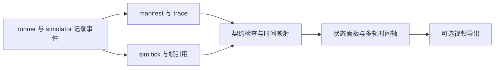

# 仿真状态与推理时间轴展示协议

如果要开发一个同时显示机器人画面和推理进度的 viewer，可按本页设计读取实验事件与帧引用。这个 viewer 尚未实现，建议先做离线时间轴，再扩展实时订阅。现有 case 的视频和分析图见 [操作指南](../hands-on.md)。

## 推荐布局

可以参考 [OxyGen 演示](https://github.com/air-embodied-brain/OxyGen#demo)，并排显示实验阶段、环境画面、任务状态和推理/模拟时间。每项显示都要对应日志中的时间和来源，便于区分模型推理与环境步进。

每个 run 的面板包括：

- 顶部：任务、运行模式、当前阶段，以及 synthetic / measured 标识。
- 环境：按 sim tick 关联的帧，显示观测采样时刻和实际正在执行的 chunk。
- 状态：待处理请求、输入观测、完成/释放、队列长度、action index、过期/欠载原因。
- 底部：可选择的时间轴、任务预算、模型耗时、模拟时长与终止结果。

辅助任务按真实事件显示 generating/complete/cancelled；只有完成事件时展示完整文本。token 到达时间需由对应事件提供。

## 时间轴来源必须可见

| 展示轴 | 定义 | 用途与限制 |
| --- | --- | --- |
| host measured | 同域 host event 实测时间 | 包含实际运行中的计算/等待，不能跨机器直接相减 |
| simulation | simulator 的逻辑 tick/时间 | 表示动力学推进，不代表 GPU 实际计算时间 |
| composed presentation | 串行协议下将实测推理片段与模拟执行片段拼接 | 静态演示可用，显式标“重建展示时间”；不冒充完整 wall-clock trace |

静态串行示例：推理 80 ms、动作 50 ms 可组成 130 ms 展示周期，推理段保留环境帧。动态协议须实际推进并记录这 80 ms 的状态；真实异步在共同时间轴绘制多轨重叠。

视频 FPS 与 control Hz 分别记录；25 FPS 编码可对应其他控制频率。展示元数据包含采样/重复/插值、settling、warmup、变速和裁剪。并排比较使用相同时间基准与播放速度。

媒体契约定义 `source_frame_id`、`observation_id`、capture clock/timestamp、sim tick、视频 PTS 与 `repeated_from`。重复帧沿用原观测 ID；环境确实冻结时标 paused，继续步进但显示旧图时标“最近采样画面”。无原始 trace 的视频标明时间关系不可验证。

## 数据流

初版 UI 可以先使用 v1 已有事件，并明确显示是否有对应画面。需要图像引用、逐 token 进度、cache 状态或播放信息时，按 [格式变更流程](artifacts.md)添加字段。

## 运行开销与验收

离线渲染读取持久化 artifact。实时扩展使用有界队列/独立进程：慢消费者丢显示帧并计数，关键事件独立保留，压缩与绘图隔离于控制线程。benchmark 比较 tracing 开/关开销。

验收包括：点动作可追踪来源观测；完成但未释放的结果不会画为可执行；终止后晚回调只画诊断；cross-clock age 不显示伪数字；有重叠时不双算时长；无视频帧时明确显示缺失。截图检查布局，事件断言检查语义，两者分别记录。
